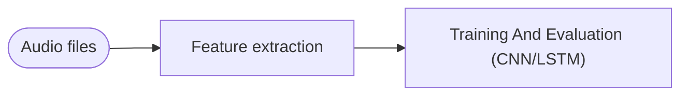
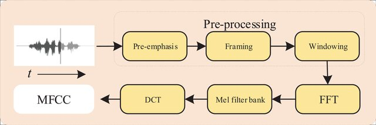

---
# Emotion Recognition From Speech

Deep learning techniques for speech recognition

**Author**: Anh Dung Le  
**Date**: November 2026  
**License**: [CC BY 4.0](https://creativecommons.org/licenses/by/4.0/deed.en)  
@CodeAlpha 2026 Internship

***

##  1. Objective 

The general workflow of this work is

##  2. Data information 

Emo-DB

##  3. Feature extraction 

###  3.1 Features encoded in the filename 

###  3.2 Mel-Frequency Cepstral Coefficients (MFCCs) extraction 

The MFCCs-extraction workflow is depicted as follows (source: [Xia et al (2020)](https://journals.sagepub.com/doi/10.1177/1729881420976082?utm_source=researchgate.net&utm_medium=article))

(in progress)

##  4. Convolutional Neural Network (CNN) 

(in progress)

