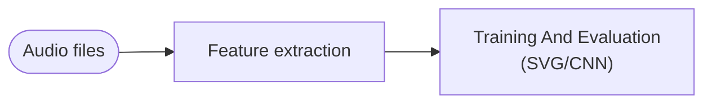
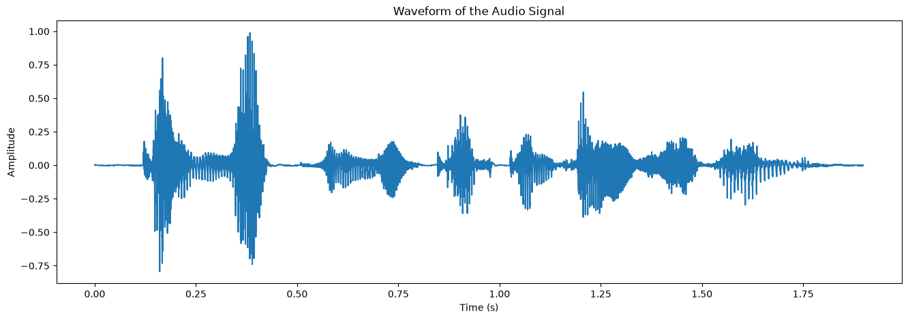
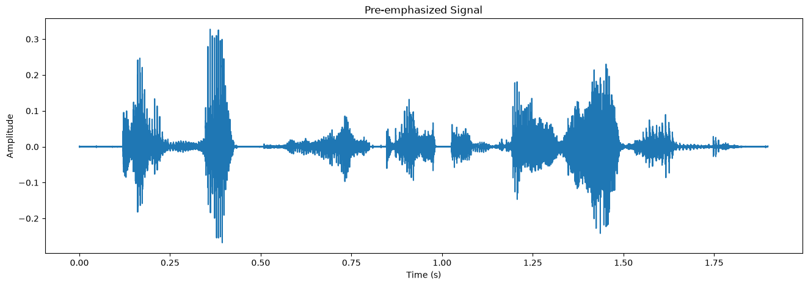
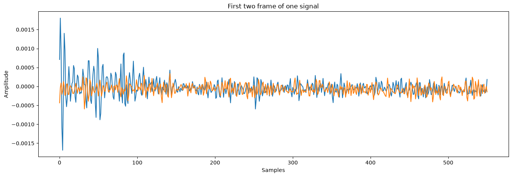
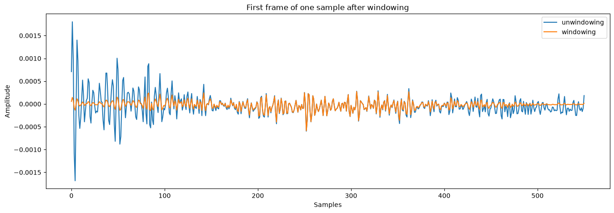
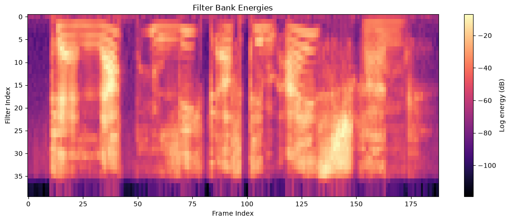
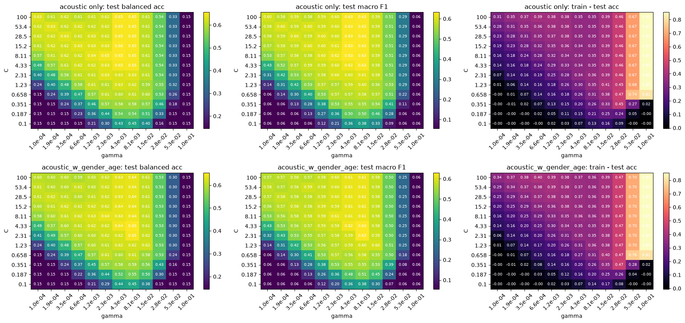
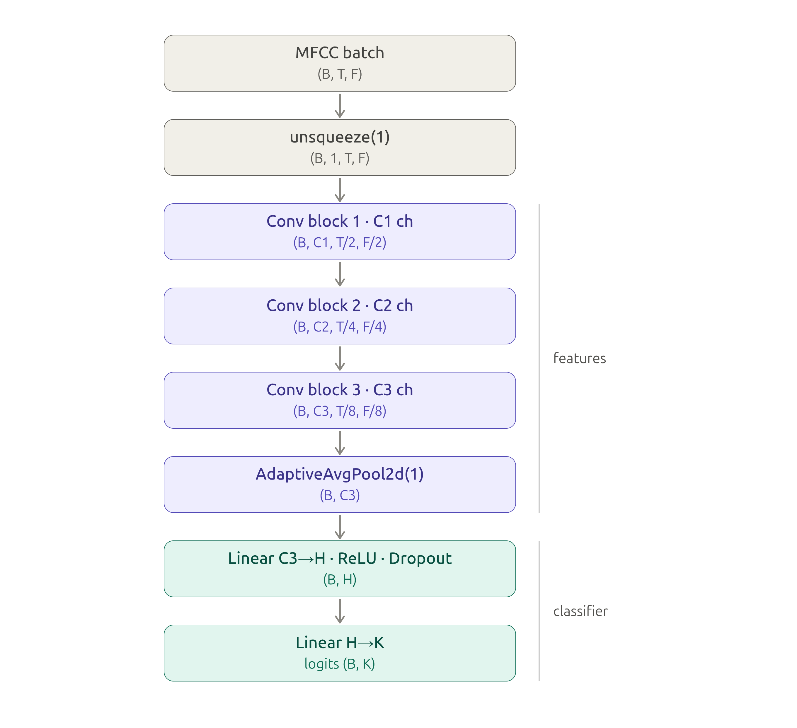
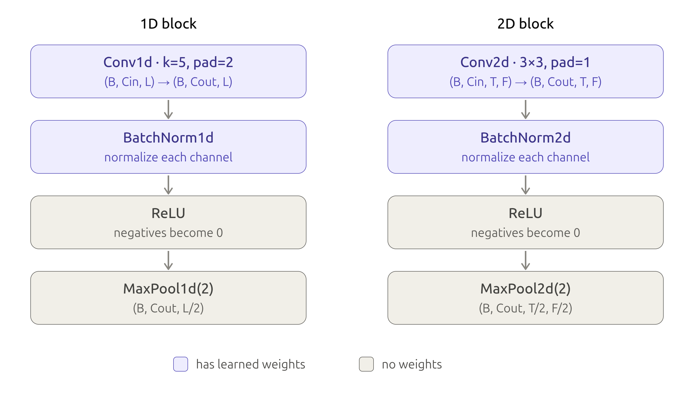

---
# Emotion Recognition From Speech

Deep learning techniques for emotion recognition

**Author**: Anh Dung Le  
**Date**: November 2026  
**License**: [CC BY 4.0](https://creativecommons.org/licenses/by/4.0/deed.en)  
@CodeAlpha 2026 Internship

***
## Table of Contents

1. [Objective](#1-objective)
2. [Data Information](#2-data-information)
3. [Feature Extraction](#3-feature-extraction)   
    3.1 [Metadata and data cleaning](#31-metadata-and-data-cleaning)   
    3.2 [Mel Frequency Cepstral Coefficients (MFCCs) extraction](#32-mel-frequency-cepstral-coefficients-mfccs-extraction)
4. [Baseline: SVC](#4-baseline-svc)
5. [Convolutional neural network (NCC)](#5-convolutional-neural-network-cnn)  
[References](#references)
***
<a id="s01"></a>
## <font color="orange"> 1. Objective </font>

The objective of this project is to build and compare machine learning and deep learning systems that automatically recognize human emotions from speech audio. Using a labeled dataset of recorded utterances (with emotions such as anger, fear, happiness, and boredom), we follow two complementary approaches:
- First, as a baseline, we extract utterance-level statistical features, namely the mean and standard deviation of MFCCs and their delta coefficients, and use them to train a classical machine learning model. 
- Second, we feed the full frame-level MFCC sequences into deep learning models, which can learn temporal and spectral patterns directly from the data rather than relying on hand-crafted summary statistics.

In both approaches, we also incorporate speaker metadata, namely age and gender, alongside the acoustic features. 

By comparing the two approaches, the project aims to assess how much performance is gained from learning on the complete MFCC representation versus compact statistical features, and to identify which models recognize emotion most accurately.

The general workflow of this projects is as follows:



<a id="s02"></a>
## <font color="orange"> 2. Data information </font>

The dataset used in this project is the Emo-DB dataset.

The Emo-DB database [[1]](#R1) is the freely available German emotional database. The database is created by authors from the Institut für Sprache und Kommunikation, Technische Universität Berlin (TU Berlin), Germany. In this project, ten professional speakers (five males and five females) participated in data recording.

- Name: Emo-DB
- Authors: Walter F. Sendlmeier, Felix Burkhardt, Miriam Kienast, Benjamin Weiss, Astrid Paeschke.
- License: [CC0-1.0](https://creativecommons.org/publicdomain/zero/1.0/)
- Links:
    - [emodb](http://emodb.bilderbar.info/index-1280.html)
    - [github](https://github.com/audeering/datasets/tree/main/datasets/emodb)


<a id="s03"></a>
## <font color="orange"> 3. Feature extraction </font>

### <font color="gree"> 3.1 Metadata and data cleaning </font>

The Emo-DB dataset (v2.0.0) can be downloaded with the Python library [audb](https://github.com/audeering/audb): 

```python
db = audb.load("emodb", version="2.0.0", full_path=True, verbose=True)
```

The metadata (age and gender) of the speakers can be extracted with:

```python
db["files"].get(map={"speaker": ["speaker", "gender", "age"]})
```

The emotion labels can be obtained using: 
```python
db["emotion"].get()
```

There are two addition properties associated to the emotional labels: naturalness and confidence. The original EmoDB authors [[1]](#R1) treat utterances with confidence above 80% and naturalness above 60% as the reliable subset. Here we lower down these thresholds to keep more data: 70% for confidence, and 50% for naturalness.  

### <font color="gree"> 3.2 Mel-Frequency Cepstral Coefficients (MFCCs) extraction </font>

The MFCCs-extraction workflow is depicted as follows (see Ref.[[2]](#R2)):


#### **Pre-emphasis**
This first step is to enhance high-frequency components of the signals. This is because speech naturally loses energy at higher frequencies. Emphasizing these frequencies will improve speech clarity and quality.

<center>


Original signal



Pre-emphasized signal
</center>

#### **Framing**
The speech signal is divided into small duration blocks (frames) and the spectral analysis is carried out on these frames. We analyse small blocks instead of the whole speech because some characteristics like pitch and tone will change with time. The frame move forwards a short period each time (frame stride). Frame stride should be shorter than frame size. Her wee pick frame size to be 25 ms and frame stride to be 10 ms.

<center>


Two examples of frame
</center>

#### **Windowing**
Each frame will be multiplied by a window (tapering) function to reduce the effect of discontinuity introduced by the framing:

```math
x_{w}[n] = x_{i}[n]\cdot w(n),
```
where x_{w}[n] is the resulting frame at index $n$, $x_{i}[n]$ is the input frame at index $n$, and $w(n)$ is the window function. In this analysis, we use the Hamming window (see [Wikipedia](https://en.wikipedia.org/wiki/Window_function)). 
<center>


Before and after windowing
</center>

#### **Fast Fourier Transform (FFT)**
In the next step, the signal (each frame) will be transformed from time domain to frequency domain, using the Fourier Transform. FFT is a fast algorithm for doing such the transform. The brute-force approach for Discrete Fourier Transform (DFT) is slower.

#### **Mel filter bank**
Humans hear loudness differently depending on the frequency. In addition, as higher frequencies, perceived frequency resolution declines. A Mel-filterbank will divide the FFT output into frequency bands, capturing the energy level of each band. It will then highlight frequencies that are perceptually important to human hearing.

In reality, sound loudness is measured in decibel (dB), which is a log transform of power. Here, we also apply such a log transform to the output of the Mel filterbank to create a representation that more closely matches how humans perceive sound intensity:

```math
(dB) = 10 \log_{10} (P_{Mel}).
```

<center>


Mel Energy Heatmap
</center>


#### **Discrete Cosine Transform (DCT)**
The final steps is to apply the DCT to the log Mel. This is to decorrelate the log-filterbank energies, producing the cepstral coefficients.

<center>


Mel Energy Heatmap
</center>


> **Note:** The Python library librosa also offers mfcc extraction, using Hanning windowing instead of Hamming. Here I prefer doing it by myself step-by-step.

The full MFCCs are stored as input features for Deep Learning workflows. 
The means and stdevs of MFCCs (over frames), and of their first detivative (delta MFCCs), are also calculated as features for the baseline classical ML algorithm. 

## <font color="orange"> 4. Baseline: SVC </font>

I used two pipelines with and without PCA (no tuning), and examine the model performance with different values of C and gamma. Two pipelines give almost the same results (so PCA does not really help). The performance of the pipeline without PCA is given below.

<center>


Without PCA
</center>

The heatmaps show that the best test balanced accuracy is about 0.65 (macro F1 about 0.63), reached in a broad plateau at intermediate gamma (about 2e-3 to 1.5e-2) and $C \ge 2$. For large gamma ($\ge 0.05$) the model overfits severely: the train-test accuracy gap exceeds 0.65 and test balanced accuracy falls to chance level (about 0.15). Even in the best region, the gap remains around 0.35, indicating that the SVC fits the small EMO-DB training set far better than it generalizes. For very small C and gamma the model underfits. Adding gender and age to the acoustic features does not improve results. Overall, the SVC achieves only moderate performance on EMO-DB.


## <font color="orange"> 5. Convolutional Neural Network (CNN) </font>

###  <font color="green"> **5.1 Preparation** </font>
- Pick 2 participants (1 male + 1 female) for test set
- Pick 2 participants (1 male + 1 female) for validation set
- Perform standard normalization of mfcc data, with mean and stdev from training set (no leakage) 
- Time-length fixing: force all MFCC data having the same number of time frames (T). T is set to be the number of time frames where 95% of training mfcc data is shorter than or equal to.
- Compute class weights for training (the EmoDB dataset is mildly imbalanced)

### <font color="green"> **5.2 Model construction** </font>
I use both one-dime and two-dim CNN constructions for the modelling. The workflows are shown below.
<p align="center">



CNN workflows
</p> 
<p align="center">


Convolutional block
</p>


<a id="s-ref"></a>
## <font color="orange"> References </font>
<a id="R1">[1]</a> 
F. Burkhardt, A. Paeschke, M. Rolfes, W. Sendlmeier, and B. Weiss, 
"A database of German emotional speech," 
in Proc. Interspeech, 2005, pp. 1517–1520.

<a id="R2">[2]</a> 
L. Xia, G. Chen, X. Xu, J. Cui, Y. Gao, 
"Audiovisual speech recognition: A review and forecast," 
in Int. J. Adv. Robot. Syst., 2020, vol.17, p.1729881420976082.
