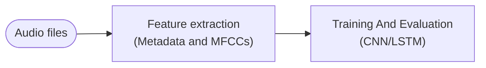
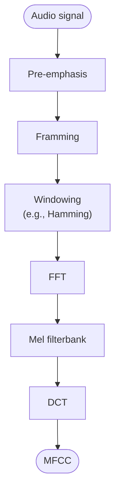

---
# Emotion Recognition From Speech

Deep learning techniques for emotion recognition

**Author**: Anh Dung Le  
**Date**: November 2026  
**License**: [CC BY 4.0](https://creativecommons.org/licenses/by/4.0/deed.en)  
@CodeAlpha 2026 Internship

***

##  1. Objective 

The objective of this project is to build and compare machine learning and deep learning systems that automatically recognize human emotions from speech audio. Using a labeled dataset of recorded utterances (with emotions such as anger, fear, happiness, and boredom), we follow two complementary approaches:
- First, as a baseline, we extract utterance-level statistical features, namely the mean and standard deviation of MFCCs and their delta coefficients, and use them to train a classical machine learning model. 
- Second, we feed the full frame-level MFCC sequences into deep learning models, which can learn temporal and spectral patterns directly from the data rather than relying on hand-crafted summary statistics.

In both approaches, we also incorporate speaker metadata, namely age and gender, alongside the acoustic features. 

By comparing the two approaches, the project aims to assess how much performance is gained from learning on the complete MFCC representation versus compact statistical features, and to identify which models recognize emotion most accurately.

The general workflow of this projects is as follows:

##  2. Data information 

The dataset used in this project is the Emo-DB dataset.

The Emo-DB database [[1]](#R1) is the freely available German emotional database. The database is created by authors from the Institut für Sprache und Kommunikation, Technische Universität Berlin (TU Berlin), Germany. Ten professional speakers (five males and five females) participated in data recording. This was as a part of the DFG funded research project SE462/3-1 in 1997 and 1999.

- Name: Emo-DB
- Authors: Walter F. Sendlmeier, Felix Burkhardt, Miriam Kienast, Benjamin Weiss, Astrid Paeschke.
- License: [CC0-1.0](https://creativecommons.org/publicdomain/zero/1.0/)
- Links:
    - [emodb](http://emodb.bilderbar.info/index-1280.html)
    - [github](https://github.com/audeering/datasets/tree/main/datasets/emodb)

##  3. Feature extraction 

###  3.1 Metadata 

###  3.2 Mel-Frequency Cepstral Coefficients (MFCCs) extraction 

The MFCCs-extraction workflow is depicted as follows (see Ref.[[2]](#R2)):

(in progress)

##  4. Convolutional Neural Network (CNN) 

(in progress)

##  References 
<a id="R1">[1]</a> 
F. Burkhardt, A. Paeschke, M. Rolfes, W. Sendlmeier, and B. Weiss, 
"A database of German emotional speech," 
in Proc. Interspeech, 2005, pp. 1517–1520.

<a id="R2">[2]</a> 
L. Xia, G. Chen, X. Xu, J. Cui, Y. Gao, 
"Audiovisual speech recognition: A review and forecast," 
in Int. J. Adv. Robot. Syst., 2020, vol.17, p.1729881420976082.
